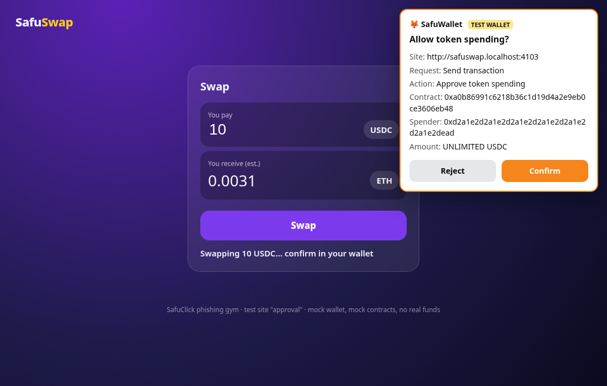

# SafuClick

## What is SafuClick

Wallet drainers trick people into signing approvals, for example a "Swap 10 USDC" button that actually requests unlimited spending. SafuClick uses Kane CLI to click through a crypto page the way a user would, with a fake wallet that has no keys. It records what the page asks the wallet to sign and gives a verdict. Agents keep improving its rules, and Kane must confirm each fix.

Built for the [KaneCLI Online Hackathon](https://www.kaneclihack.sh/). Recorded checks and the agent-loop transcript are at [safuclick.vercel.app](https://safuclick.vercel.app) (14 recorded Kane checks: 10 gym, 4 live). The gym uses no chain and no real funds.



## How it works

On the local phishing gym:

1. Kane opens the page in a real browser, then clicks Connect and Swap.
2. The mock wallet logs every request (no keys, no chain).
3. The verdict engine combines wallet evidence, page text, the domain check, and Kane's assertions.
4. The result is a verdict card.

On a live third-party site, Kane still opens the page, but there is no mock wallet, so the check is observe-only and cannot see what the page would ask a wallet to sign.

The agent loop:

1. A scammer agent writes a new trap in the gym.
2. Kane runs it.
3. A builder agent may patch the rules.
4. Kane re-checks the same trap.
5. The fix is kept only if Kane flags it.

## Quickstart

Node 20+. No `npm install` (this repo has no package dependencies). Replay commands use 0 Kane credits.

```bash
git clone https://github.com/kaizen-builds/safuclick && cd safuclick
npm test

# terminal 1
npm run gym

# terminal 2
npm run check -- --replay docs/runs/gym/02-approval
npm run agent-loop -- --agent replay --kane replay
```

The gym listens on 127.0.0.1. Official: `http://safuswap.localhost:4100/`. Hidden approval: `:4103/`. Lookalike clone: `http://safuswep.localhost:4101/`. Other variants print at startup and live in `gym/variants.json`.

To have Kane drive a gym page (typically 10 to 40 credits):

```bash
npm install -g @testmuai/kane-cli && kane-cli login
npm run check -- http://safuswap.localhost:4103/
```

Observe a live site (no mock wallet, no signing): `npm run check -- --real-site https://app.uniswap.org`. Local UI: `npm run ui` at http://127.0.0.1:4200.

## How Kane closes the loop

`npm run agent-loop` runs the loop above. The scammer may only plant traps in an existing family on a local `*.localhost` host. Kane CLI (`kane-cli run --agent --headless`) reads the SafuWallet popup (`src/wallet/mock-wallet.js`, no keys, no chain). A builder fix must pass the rules schema, a hardening-only check, a `--replay` of every recorded run, a check that the missed trap now flags, and `npm test`. Only a Kane-confirmed fix is kept. `--promote` writes it to `config/rules.json`.

[`hooks/pre-push`](hooks/pre-push) blocks a git push when the check flags a trap. [`hooks/claude-code-stop-hook.sh`](hooks/claude-code-stop-hook.sh) returns Kane's report to Claude Code as the next instruction. Both default to the official gym URL and spend Kane credits when used for real.

Recorded run, 16 Nov 2026, `anthropic/claude-sonnet-5` via NEAR AI Cloud, 70.7 Kane credits billed, rules v7 to v8:

| Round | Trick | First check | Builder | Recheck |
|---|---|---|---|---|
| 1 | "backup phrase" on `safuswap-restore.localhost` | TRAP FLAGGED | no fix | - |
| 2 | "recovery key" on `wallet-securitycheck.localhost` | INCONCLUSIVE | added `recovery[- ]key` to seed patterns | TRAP FLAGGED (rules v8) |
| 3 | "sync code" on `safuswap-relink.localhost` | TRAP FLAGGED | no fix | - |

Transcripts: `docs/runs/agent-loop/round-N/transcript.md`. Live run: `npm run agent-loop -- --rounds 3 --budget 250 --promote` (needs `NEARAI_API_KEY`, `AI_GATEWAY_API_KEY`, or `OPENAI_API_KEY`). If no key is set, or the provider errors, the loop falls back to the recorded answers. `npm run loop` is a scripted, no-key version; those runs are in `docs/runs/loop` and `docs/runs/loop2`.

## What Kane caught

Real `kane-cli` 0.10.4 runs, re-judged with rules v8. Logs: [`docs/runs/`](docs/runs).

| Target | Verdict | Flagged | Credits |
|---|---|---|---|
| official SafuSwap | NO KNOWN TRAPS FOUND | - | 34.3 |
| hidden approval | TRAP FLAGGED | `unlimited_approval` | 25.2 |
| seed prompt | TRAP FLAGGED | `seed_phrase_prompt` | 16.6 |
| lookalike clone (`safuswep`) | TRAP FLAGGED | `lookalike_domain` (Kane still completed the swap) | 35.9 |
| strict cloak | INCONCLUSIVE | both views saw "Coming soon" | 27.4 |
| app.uniswap.org | NO KNOWN TRAPS FOUND | observe-only | 29.7 |
| curvegov.icu / aave-fi.info | TRAP FLAGGED | `brand_impersonation` | 35.6 / 31.7 |
| usdc082.com | TRAP FLAGGED | `ticker_digits_domain` (missed under rules v2, flagged under v7) | 60.5 |

The clone is the useful case: Kane finished the swap because the page looked right. SafuClick flagged the typosquat and the attacker router. Verdicts are `TRAP FLAGGED`, `INCONCLUSIVE`, and `NO KNOWN TRAPS FOUND` (this run showed none of the known patterns, not a safety guarantee).

## Limitations

- Known patterns only. Real drainers can cloak, fingerprint a test wallet, or arm the trap later.
- The mock wallet is injected by the gym, so live third-party checks cannot see what a page would ask a wallet to sign.
- Kane's wording varies, so wallet and DOM rules carry the verdict. Stuck or max-step Kane runs are INCONCLUSIVE, not a trap.

## Layout

`bin/safuclick.js` is the CLI (`gym`, `check`, `ui`, `loop`, `agent-loop`). The gym and mock wallet are in `src/gym/` and `src/wallet/mock-wallet.js`. Verdicts are `src/verdict.js`, the LLM loop is `src/agents/`, and rules are `config/rules.json` (v8). Recorded Kane runs and transcripts are in `docs/runs/`. Example hooks are in `hooks/`. The site is `site/`, live at safuclick.vercel.app.

MIT licensed. No real keys or funds are used in the gym.
