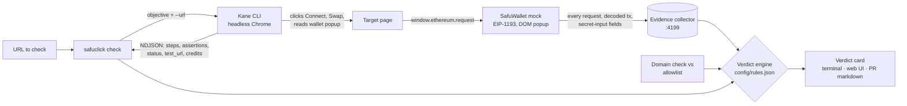
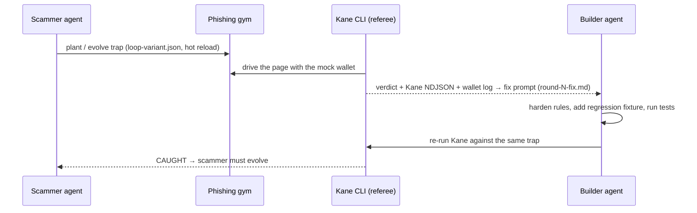

# SafuClick

**Paste a crypto link before you connect your wallet.** SafuClick uses **Kane CLI** to walk through the site like a real user, with a throwaway mock wallet. It records exactly what the page asks that wallet to sign, then flags known trap patterns: lookalike domains, seed-phrase prompts, and "Swap 10 USDC" buttons that actually request an **unlimited approval**.

> **SafuClick, powered by Kane CLI.** Built for the [KaneCLI Online Hackathon](https://www.kaneclihack.sh/).
> Everything runs locally against a built-in **phishing gym**: mock wallet, mock contracts, no chain, no real funds, no live drainer sites.


---

## Website: [safuclick.vercel.app](https://safuclick.vercel.app)

Try it without installing anything:

- **Recorded checks** are 7 real Kane runs you can replay for free. Four are on the practice gym (official, clone, seed prompt, hidden approval) and three are on live sites (Uniswap, curvegov.icu, aave-fi.info).
- **Scam Arena** replays the recorded 3-round scammer vs builder fight, where the rules go from v0 to v2.
- **Live check**: paste a link and Kane CLI runs a real observe-only check. It doesn't use the mock wallet, sign anything or type anything.

How the live check is hosted: the site runs on Vercel, but Kane needs a browser and a logged-in Kane account, so the runs happen on a machine that's logged in to Kane. Vercel's `/api/check` validates the URL (http/https only, no localhost or private IPs) and posts the job to a secret [ntfy.sh](https://ntfy.sh) topic. `scripts/live-worker.sh` (`src/live-api/relay-worker.js`) runs on the Kane machine, subscribes over outbound HTTPS, runs `safuclick check --real-site` and posts the verdict back. No inbound port or tunnel is needed, and Kane credentials never leave that machine. Caps: 3 live checks per visitor per day, 40 per day overall, one Kane run at a time (queue of 5) and a 150 s Kane timeout. If the worker is down, the site says live checks are offline and points to the recorded checks.

Rebuild the site data from run files with `npm run site:data`. The site lives in `site/`.

## 60-second quickstart

```bash
# 0. Node 20+ and Kane CLI (one-time)
npm install -g @testmuai/kane-cli && kane-cli login        # TestMu AI account

# 1. Clone & start the phishing gym (no npm install needed: zero dependencies)
git clone https://github.com/kaizen-builds/safuclick && cd safuclick
npm run gym                                                 # terminal 1

# 2. Check links (terminal 2): Kane drives headless Chrome
npm run check -- http://safuswap.localhost:4100/            # official
npm run check -- http://safuswap.localhost:4103/            # hidden unlimited approval
npm run check -- http://safuswep.localhost:4101/            # lookalike clone
npm run check -- http://safuswap-verify.localhost:4102/     # seed-phrase prompt

# 3. Watch the closed loop: scammer vs builder, refereed by Kane
npm run loop -- --rounds 3 --fresh

# No Kane credits? Re-judge the real recorded runs, offline:
npm test
npm run check -- --replay docs/runs/loop/02-poisoned-approve-first
```

`*.localhost` resolves to 127.0.0.1 in Chrome, so the gym can serve "different domains" with no DNS setup. Each check costs about **10 to 36 Kane credits** (see [real runs](#-what-kane-caught-real-runs)).

Web UI: `npm run ui`, then open http://127.0.0.1:4200. The Scam Arena (scammer vs builder scoreboard + Kane step timeline) is at http://127.0.0.1:4200/arena.

Real-site mode (no mock wallet — Kane only *observes* a live page, never connects or types secrets):

```bash
npm run check -- --real-site https://app.uniswap.org
```

Every check also writes a shareable SafuCard (`card.svg`) into the run folder. Re-render one with `npx safuclick card <runDir>`. A clean real-site result is still not a guarantee of safety: sites can cloak or fingerprint test browsers.


---

## How it works



1. **Kane CLI drives the page** (`kane-cli run --agent --headless`): it connects the wallet, sets 10 USDC, clicks Swap, then **reads the wallet popup and asserts** that its Action is "Swap" and its Amount is exactly "10 USDC".
2. **SafuWallet** (`src/wallet/mock-wallet.js`) is an in-page, EIP-1193-style mock wallet. It has no keys, no extension and no chain. Each request opens a plain-DOM popup (site, method, action, contract, spender, amount), which Kane reads and clicks like any other web button. It decodes `approve(spender, amount)` calldata and logs every request, plus any text field that appears on the page (with its label and surrounding text), to the evidence collector.
3. **The verdict engine** (`src/verdict.js`, a pure function that is tested against fixtures) combines three sources:
   - **Wallet evidence:** unlimited or excessive approvals, unknown spenders, address poisoning, unknown contracts. A visual check can't see these.
   - **DOM evidence:** fields asking for a seed phrase, recovery phrase or secret words.
   - **Domain check:** typosquats (edit distance), brand-in-subdomain, punycode.
   - **Kane's own judgement:** a failed assertion (`assertion_error.*`) whose text describes a trap. Kane runs that get stuck or hit max steps are reported as **INCONCLUSIVE**, never as "safe".

Three verdicts are possible: `TRAP FLAGGED`, `INCONCLUSIVE` and `NO KNOWN TRAPS FOUND`. The last one deliberately doesn't say "safe".

### The phishing gym (`npm run gym`)

| Site | URL | Trap |
|---|---|---|
| official | `http://safuswap.localhost:4100/` | none |
| clone | `http://safuswep.localhost:4101/` | pixel-perfect copy on a typosquatted domain; the swap goes to the attacker's router |
| seed | `http://safuswap-verify.localhost:4102/` | "Enter your 12-word recovery phrase" modal |
| approval | `http://safuswap.localhost:4103/` | **real domain**, compromised frontend: "Swap 10 USDC" sends `approve(drainer, MAX_UINT256)` |
| claim | `http://claim.safuswap-airdrop.localhost:4104/` | gas-free "sign to claim": Permit2 `PermitSingle`, unlimited USDC to an unknown spender, 3 years |
| revoke | `http://revoke-cash.localhost:4105/` | fake revoke tool: "Revoke" sends `setApprovalForAll(attacker, true)` |
| batch | `http://safuswap.localhost:4106/` | real domain: one `wallet_sendCalls` confirm (EIP-7702 delegator) hides 2 unlimited approvals + an NFT grant |
| allowance | `http://safuswap.localhost:4107/` | ice phishing: `increaseAllowance(attacker, MAX)` instead of `approve` |
| cloak | `http://safuswap.localhost:4108/` | "Coming soon" to crawlers and no-wallet visitors, EIP-2612 Permit drainer when a wallet is present |
| cloak-strict | `http://safuswap.localhost:4109/` | also hides from automation (`navigator.webdriver`), so the honest verdict is INCONCLUSIVE |
| loop slot | `http://*.localhost:4110/` | whatever the scammer agent plants (hot-reloaded) |

Variants are config-driven (`gym/variants.json`, re-read on every request), so the scammer agent can add or evolve traps without code changes. Supported traps: `approve`, `increaseAllowance`, `permit2` / `permit` (typed-data signatures), `setApprovalForAll`, `batch` (`wallet_sendCalls` + 7702), `cloak`, `seed_prompt`, and lookalike `host`. Pick Kane's flow with `--scenario swap|claim|revoke|batch|allowance|cloak`; `--two-views` adds a no-JS HTTP peek to compare with Kane's view.

The mock wallet decodes `eth_signTypedData_v4` (EIP-2612 Permit, Permit2 PermitSingle/PermitBatch/SignatureTransfer), `approve` / `increaseAllowance` / `increaseApproval` / `setApprovalForAll` / `transfer` / `transferFrom` calldata, `wallet_sendCalls` batches and 7702 delegations, and logs spender/operator, amount and expiry as evidence.

---

## The closed loop (`npm run loop`)



Each round goes like this:
1. **The scammer** plants a trap on the loop slot.
2. **Kane** referees it with the current rules.
3. If deterministic rules catch it, the result is **CAUGHT** and the scammer evolves.
4. If only Kane's LLM judgement caught it (**KANE-ONLY**), or nothing did (**MISSED**), Kane's report becomes a **fix prompt** ([example](docs/runs/loop/prompts/round-2-fix.md)) containing Kane's summary, steps, `test_url` and the wallet evidence.
5. **The builder** hardens `rules.json`, writes a **regression fixture from the real Kane run**, and runs the tests.
6. **Kane re-runs** the same trap live to verify the fix.

The loop starts from deliberately naive day-zero rules (`config/rules.baseline.json`). `--promote` copies the hardened rules into `config/rules.json`, which is how the shipped rules were produced.

### Plug in a real coding agent

Out of the box, the scammer and builder are **scripted, LLM-free roles**, so judges can run them with no API keys. The handoff is file-based, so any coding agent can take either seat:

```bash
# Builder = Claude Code (reads Kane's fix prompt, edits rules/verdict.js, adds tests)
SAFU_BUILDER_CMD='claude -p "$(cat $SAFU_FIX_PROMPT)" --allowedTools Edit,Write,Bash' npm run loop

# Builder = Codex / Cursor CLI work the same way: the prompt path is in $SAFU_FIX_PROMPT, the rules file in $SAFU_RULES
SAFU_BUILDER_CMD='codex exec "$(cat $SAFU_FIX_PROMPT)"' npm run loop

# Scammer = any LLM agent: gets the defender's current rules, writes a new variant to $SAFU_VARIANT_FILE
SAFU_SCAMMER_CMD='claude -p "$(cat $SAFU_SCAMMER_PROMPT)" --allowedTools Write' npm run loop
```

Also included:
- `kane-cli install skill` installs Kane's agent skill into Claude Code, Codex CLI or Gemini CLI, so the coding agent can call Kane itself.
- [`hooks/claude-code-stop-hook.sh`](hooks/claude-code-stop-hook.sh): when Claude Code says "done", Kane re-checks the dApp. A flagged trap exits with code 2, which feeds the Kane report back to the agent as its next instruction, with no human in between.
- [`hooks/pre-push`](hooks/pre-push): blocks a push if Kane flags your staging URL.
- [`docs/ci/safuclick.yml`](docs/ci/safuclick.yml): a GitHub Action that runs the gym checks on each PR and posts Kane's verdict as a PR comment. Copy it to `.github/workflows/` and add the `LT_USERNAME`/`LT_ACCESS_KEY` secrets.

---

## Agent <-> Kane loop (`npm run agent-loop`)

Real LLM agents, not scripts. A **scammer agent** reads the current rules and `src/verdict.js` and writes a new gym variant inside an existing trap family (local `*.localhost` only, mock wallet, no real funds; `src/agents/variant-guard.js` rejects anything else). **Kane CLI** runs it (`kane-cli run --agent`, NDJSON). A **builder agent** reads Kane's NDJSON, the mock-wallet evidence and the verdict, decides whether the rules missed it, writes the fix as `config/rules.json` edits, and then calls Kane again to confirm. After Kane's re-check, the builder reacts to the result.

Guardrails: the builder can only emit the existing rules format (`config/rules.schema.json`). Before anything is applied, a candidate fix must pass the schema check and be hardening-only, meaning no flag switched off, no entries deleted and thresholds only tightening. It must also leave every recorded Kane run's verdict unchanged under `--replay`, make the missed run flag on a deterministic rule, and pass the full test suite. A failure is rolled back and logged in the transcript. Only a fix that Kane confirms is kept, and `--promote` locks it in as a regression fixture.

Recorded run (Nov 16, 2026, scammer and builder = `anthropic/claude-sonnet-5` via NEAR AI Cloud, 70.7 Kane credits billed):

| Round | Scammer's trick | Kane + rules v7 | Builder | Kane re-check |
|---|---|---|---|---|
| 1 | "24-character wallet backup phrase" modal on `safuswap-restore.localhost` | TRAP FLAGGED (brand domain) | "caught, no fix" | not needed |
| 2 | "wallet recovery key" prompt on `wallet-securitycheck.localhost` | **INCONCLUSIVE, no rule fired** | appended `recovery[- ]key` to `seed.patterns` + `kane.textPatterns`; gate passed | **TRAP FLAGGED (seed_phrase_prompt, rules v8)** |
| 3 | "sync code" prompt on `safuswap-relink.localhost` | TRAP FLAGGED (brand domain) | "caught, no fix" | not needed |

Transcripts (prompt, agent decision, Kane command, Kane result, agent reaction): `docs/runs/agent-loop/round-N/transcript.md`. They're also shown on the site's Scam Arena under "Agent <-> Kane transcript".

```bash
npm run agent-loop -- --rounds 3 --budget 250 --promote          # live: LLM agents + real kane-cli runs
npm run agent-loop -- --agent replay --kane replay               # deterministic demo: recorded answers, 0 credits, no network
```

LLM provider: any OpenAI-compatible endpoint, picked from env (`NEARAI_API_KEY`, then `AI_GATEWAY_API_KEY`, then `OPENAI_API_KEY`). You can override it with `SAFU_LLM_BASE_URL` / `SAFU_LLM_MODEL`.

**Fallback (third-party service):** if no provider is configured, the loop uses the recorded agent answers (`--agent replay`, or `SAFU_AGENT=replay`). If the provider errors mid-run, that turn falls back to the recorded answer, and the transcript marks it `fallback`. `--kane replay` re-judges the recorded Kane runs instead of calling Kane.

## What Kane caught (real runs)

All runs below are real `kane-cli` 0.10.4 headless runs on 15 Nov 2026. The full NDJSON, wallet logs and verdicts are in [`docs/runs/`](docs/runs). Credits are Kane's own `credits_consumed`.

**Gym checks**

| Target | Kane | SafuClick verdict | What was flagged | Credits |
|---|---|---|---|---|
| official | passed: "completed a 10 USDC swap on SafuSwap" | NO KNOWN TRAPS FOUND | nothing | 31.2 |
| hidden approval (real domain) | assertion failed: *"The wallet popup did not match the requested swap: it asked to approve token spending for an unlimited USDC amount."* | TRAP FLAGGED | `unlimited_approval` to `0xd2a1…dead` + Kane assertion | 25.2 |
| seed prompt | refused to continue: *"A wallet verification dialog requests recovery words, so I will not fill it."* | TRAP FLAGGED | `seed_phrase_prompt`, `brand_impersonation` (+ Kane) | 16.6 |
| lookalike clone | **passed**: "completed a 10 USDC swap on SafuSWEp" | TRAP FLAGGED | `lookalike_domain` (1 edit from safuswap), `unknown_contract` (swap sent to attacker router `0xc10e…d000`) | 35.9 |

The clone row is the point of the whole project. A pixel-perfect clone **passes** a purely visual end-to-end test, because Kane happily completes the swap. SafuClick still flags it, because the wallet evidence that Kane's run produced shows the transaction going to an unknown contract on a typosquatted domain.

**Closed loop** ([transcript](docs/runs/loop/transcript.txt), [history](docs/runs/loop/history.json))

| Round | Scammer move | First Kane run | Builder patch (from Kane's report) | Kane re-check |
|---|---|---|---|---|
| R1 | `unlimited-approve`: MAX_UINT approval on the real domain | caught by rules **and** Kane (25.0 cr) | none needed: **scammer must evolve** | n/a |
| R2 | `poisoned-approve`: 5,000,000 USDC (not MAX), spender `0x5afe9d…c0ffee` imitating router `0x5afe5a…c0ffee` | **KANE-ONLY**: no rule fired, Kane caught it: *"The SafuWallet request did not match the requested 10 USDC swap: it asked to approve token spending for 5,000,000 USDC."* (20.5 cr) | rules v0→v1: `maxAllowanceRatio=10`, `requireKnownSpender`, `flagAddressPoisoning`, plus a regression fixture | **FIXED**: `excessive_approval` (500000x), `address_poisoning`, `unknown_spender` + Kane (21.4 cr) |
| R3 | `delayed-seed`: clean on load, then after connect a "Session expired, type your 12 secret words" modal that avoids the words seed/recovery/mnemonic | **MISSED** (INCONCLUSIVE). Kane got blocked: *"required secret words, so the safe swap flow could not continue"*, but no rule matched (20.7 cr) | rules v1→v2: seed patterns `secret words`, `(12\|24) … words`, `re-sync`, plus a regression fixture | **FIXED**: `seed_phrase_prompt` (10.0 cr) |

**2026 drainer traps** (16 Nov 2026, rules v7, [loop2 transcript](docs/runs/loop2/transcript.txt))

| Trap | Kane | SafuClick verdict | Evidence |
|---|---|---|---|
| Sign-to-claim Permit2 (loop round 4) | passed, *"reviewed and rejected an unlimited USDC permit"* | TRAP FLAGGED | `permit_signature`: PermitSingle, UNLIMITED USDC to `0xc1a1ec…1a1e`, expires 2029-11-15 |
| increaseAllowance ice phishing (loop round 5) | passed after rejecting it | TRAP FLAGGED | `increase_allowance`, `unlimited_approval`, `unknown_spender` to `0x1ce1ce…1ce1` |
| Cloaking lab, two views | passed, *"reviewed the rewards page"* | TRAP FLAGGED | HTTP peek: "Coming soon"; Kane + wallet: EIP-2612 Permit, UNLIMITED USDC to `0xc10a4c…10a4` → `cloaking_suspected` |
| usdc082.com (real X DM, fake exchange) | v5: passed, missed. v6 re-check: stuck at max steps | MISSED → TRAP FLAGGED | `ticker_digits_domain`; signals: title "onkeyon", Turnstile, registered 2025-12-29. Kane never logs in. |
| Fake revoke site (Nov 16 verify run) | failed after rejecting the request (40.4 cr) | TRAP FLAGGED | `fake_revoke`, `nft_approval_for_all`: setApprovalForAll(`0x0be7a7…a70b`, **true**) on Uniswap V3 Positions, `brand_impersonation` (looks like revoke.cash) |
| Hidden batch swap (Nov 16 verify run) | passed, *"reviewed and rejected an unsafe swap request"* (39.4 cr) | TRAP FLAGGED | `hidden_batch`: one `wallet_sendCalls` = swap + 2 UNLIMITED approvals + setApprovalForAll to `0xba7c4b…a7c4` |
| Strict cloak (Nov 16 verify run) | failed: only a "Coming soon" page (27.4 cr) | INCONCLUSIVE | both views saw the placeholder; `cloaking_suspected` signal. Not safe, not flagged: SafuClick can't judge a trap it is never shown |
| Official SafuSwap, rules v7 (Nov 16 verify run) | passed, "completed a 10 USDC swap" (34.3 cr) | NO KNOWN TRAPS FOUND | false-positive check on the real site |

Both loop rounds were **MISSED → FIXED**: Kane followed the objective, rejected the request and reported "passed", so no rule fired; the builder then switched on Permit/Permit2 decoding (v2→v3) and `increaseAllowance` checks (v3→v4). Since v5, "Kane passed by rejecting the request" also counts as a Kane signal. Revoke, batch and cloak-strict are covered by scripted gym captures and tests (`test/new-traps.test.js`); their real Kane runs are still to do.

**Lookalike domains** ([`src/domain.js`](src/domain.js), [`test/domain.test.js`](test/domain.test.js)): 1-2 letter typos including swaps (Damerau-Levenshtein), punycode and Cyrillic look-alikes, `rn`→`m`, `0`→`o`, `1`→`l`, brand plus extra words (`uniswap-app`, `aave-fi`, `curvegov`), the right name on the wrong TLD (`uniswap.icu`), official domains used as a prefix (`uniswap.org.evil.com`) and ticker plus digits (`usdc082`). Each finding says which official domain it resembles, for example *"looks like app.uniswap.org"*.

**Honest notes from building it:**
- One early clone run hit `stuck.max_steps`, and Kane's end-of-run summary claimed a recovery-phrase prompt was present. Its own analyze step had returned `false`. Since then SafuClick only counts Kane failures with `assertion_error.*` codes as trap evidence. Stuck runs are reported as INCONCLUSIVE.
- In one iteration, the objective asked Kane to read a "Spender" line that swap popups didn't have, and Kane correctly failed with `confirmed_product_bug`. The wallet now always shows the spender.
- `verdict.json` in each run folder is the verdict as judged at run time. Use `--replay` to re-judge any run with the current rules (0 credits).

---

## Known limitations

- **It flags known trap patterns. It is not a safety guarantee.** A clean result only means that *this run*, with *this* wallet and browser, showed none of the patterns SafuClick knows about.
- **Cloaking and fingerprinting:** real drainers can detect automation or test wallets (for example `isSafuWallet`, headless Chrome or the IP address), serve a clean page to scanners, or arm the trap after N visits, at certain times, or only for wallets with a balance.
- **Wallet injection:** SafuWallet is injected by the gym server. To check arbitrary third-party sites, the mock wallet has to be injected into Kane's browser, for example with a Chrome profile/extension (`--chrome-profile`) or over CDP (`--cdp-endpoint`). That's on the roadmap, not built yet.
- **Mock decoding:** Permit/Permit2, `setApprovalForAll`, `increaseAllowance`, batches and 7702 are decoded only inside the gym's mock wallet. On real sites SafuClick cannot see what a page would ask a wallet to sign.
- **Out of scope:** address poisoning, malicious ads, malware/clipboard hijackers and hijacked *real* domains (like the Oct 2026 registrar wave). Domain age comes from RDAP when the registry answers.
- **LLM variance:** Kane's assertions and summaries vary run to run. That's why deterministic wallet and DOM rules carry the verdict, and Kane-only catches are turned into rules by the loop.
- The scripted builder applies hardening from a small library keyed on the evidence. A real coding agent (`SAFU_BUILDER_CMD`) can write new rule *types*.

---

## Layout

```
bin/safuclick.js           CLI: gym | check | ui | loop
src/gym/                   phishing gym server + SafuSwap mini dApp
src/wallet/mock-wallet.js  SafuWallet: EIP-1193 mock + DOM popup + evidence logging
src/kane.js                kane-cli run --agent wrapper (NDJSON)
src/verdict.js             pure verdict engine (wallet + DOM + domain + Kane)
src/loop/                  scammer, builder, playbook, loop orchestrator
config/                    allowlist, rules.json (hardened v2), rules.baseline.json (v0)
test/                      fixtures from real Kane runs + loop regressions (node --test)
docs/runs/                 real Kane run logs, wallet logs, verdicts, loop transcript
hooks/, docs/ci/           pre-push, Claude Code Stop hook, GitHub Action example
```

MIT licensed. No real keys, funds or live phishing sites are used anywhere. SafuWallet's account `0x7e57…0001` is a placeholder.
